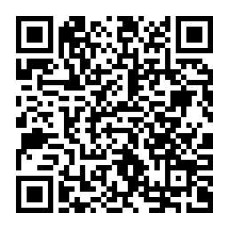

**Install:** `FractumMorrowind.cia` with FBI (Remote Install > Scan QR Code, or copy it to the SD card), on a New 3DS
or an Old 3DS.

At its first start it downloads Morrowind, Tribunal and Bloodmoon over Wi-Fi from halomaps.fractumseraph.net, each
console its own set; a download cut off carries on where it stopped. With an SD card reader, unzip your console's data
zip from https://halomaps.fractumseraph.net/mw3ds/ to the card's root instead (the README says which). Later versions
update themselves.

**Online:** the Online button plays on morrowind.fractumseraph.net with the people in the browser. Make your account
with **New account** on the 3DS (invite code `fractumseraph.net`). docs/ONLINE.md has the rest.

**Wear OS watches and Android:** `FractumMorrowind-android.apk` (32-bit ARM, for a Galaxy Watch's Android; install it
with `adb install`). It downloads the same game data at its first start, plays online on the same server, and asks to
update itself when a new version is out. android/README.md has the controls.

MW3DS-Converter makes a CIA from your own Morrowind install instead.
